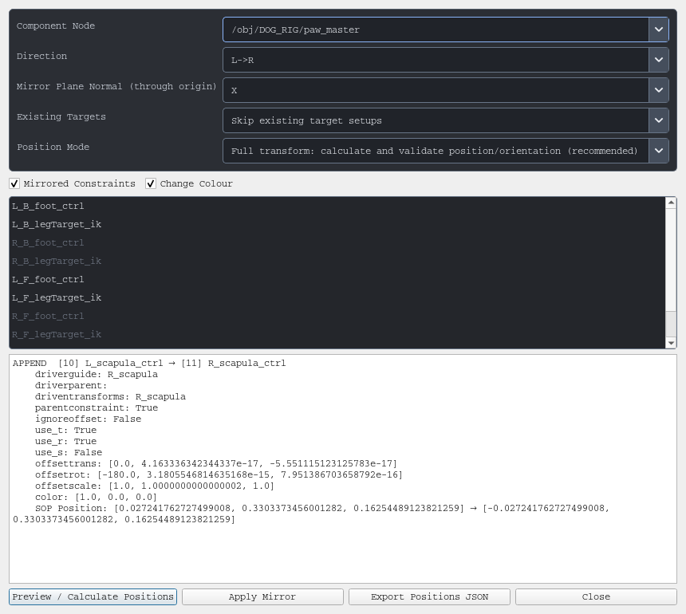

# APEX Setup Mirror

A Houdini Python tool for mirroring selected **APEX AutoRig Component / Transform Driver setups** between the left and right sides of a character.



## Features

- Select multiple setups from a list of driver names.
- Mirror `L -> R` or `R -> L` across X=0, Y=0, or Z=0.
- Remap driver, guide, parent, driven-transform, and tag references using complete L/R name tokens, such as `L_arm`, `arm_L`, and `bindjoint__L_arm`.
- Copy constraint options and let the component rebuild the corresponding constraints.
- Solve full mirrored rest transforms against the target guides, including different guide orientations, then validate positions and rotations before and after applying changes.
- Skip or update existing target setups.
- Optionally include parent/guide setup dependencies with **Mirrored Constraints**.
- Optionally set mirrored left controls to blue and right controls to red with **Change Colour**.
- Export mirrored setup parameters, positions, and matrices as JSON.
- Undo changes in one step or restore the embedded setup backup.

## Requirements

Tested with **Houdini 22.0.466**. Run inside the Houdini GUI; no additional Python packages are required.

The component must expose the Transform Driver `setups` multiparm structure. Custom snippet components using that structure are supported. Components with a different setup schema are rejected.

The tool uses Houdini's multiparm data API. Full-transform mode also requires an output guide skeleton with `name` and `transform` point attributes; its path normally comes from the component's `inputguidename` parameter.

## Run

1. Download this folder or clone the repository.
2. In Houdini, select the APEX AutoRig Component you want to edit.
3. Create a Shelf Tool, set its script language to **Python**, and paste the following code. Replace `script_path` with the location of the downloaded script.

```python
import runpy

script_path = r"C:\path\to\yfu_pyTools\HOUDINI\APEX_Setup_Mirror\apex_setup_mirror.py"
runpy.run_path(script_path, run_name="__main__")
```

You can also run the same code from Houdini's Python Source Editor.

## Workflow

1. Choose the **Component Node**, **Direction**, and mirror plane normal.
2. Choose whether **Existing Targets** should be skipped or updated.
3. Keep **Position Mode** set to the full-transform option to calculate and validate the final rest transforms.
4. Select driver names in the list. Use Ctrl or Shift for multiple selections.
5. Click **Preview / Calculate Positions**, inspect the result, then click **Apply Mirror**.
6. Use **Export Positions JSON** to save the computed setup and transform data.

**Mirrored Constraints** is enabled by default. It includes other setups in the same component that create the source-side parent or guide needed by the selection. The selected setups' own constraint settings are always copied; this checkbox controls dependency inclusion.

**Change Colour** is enabled by default. Mirrored L controls receive RGB `(0, 0, 1)` and mirrored R controls receive RGB `(1, 0, 0)`. When disabled, targets inherit the source setup's colour. Source setups and skipped targets retain their existing colours.

The default configuration mirrors left to right across X=0 and skips existing targets. Updating an existing target replaces its setup fields with the mirrored source data, including the colour chosen by **Change Colour**.

The tool does not save the HIP file. Save it manually after checking the result.

## Transform behaviour and limits

Full-transform mirroring operates in **character SOP space**, before any OBJ-level transforms. For a reflection matrix `S` and source transform `M`, the target is:

```text
M_target = S * M * S
```

A temporary copy of the component computes the target's actual base transform. The tool solves Offset TRS using the component's Pre-Multiply, Post-Multiply, or Override order, then validates every active target. The temporary copy is deleted after calculation. A failed final validation rolls back the setup edits.

- This tool mirrors setup configuration and rest transforms. Mirrored targets use evaluated values at the current frame; animation curves are not mirrored. Untouched setups retain their expressions and keyframes.
- Corresponding skeleton joints, guides, parents, and driven transforms must already exist or be created by included setups. The tool does not build an entire opposite-side skeleton.
- Dependencies are limited to setups in the selected component. Independent constraints in other SOP nodes or animation layers are outside its scope.
- Full-transform mode requires enabled setups and rejects offsets containing shear that cannot be represented by TRS.
- **Parameter offsets only** mirrors the parameter offsets without guaranteeing final positions. It can be used for disabled setups.
- Control-shape transforms are mirrored; arbitrary custom shape vertex topology is not rebuilt.
- Calculating full transforms cooks the component several times and may take longer on complex rigs.

## Restore the last backup

Each successful operation stores one backup of the previous setups on the node. Select the component and run:

```python
import hou
import runpy

script_path = r"C:\path\to\yfu_pyTools\HOUDINI\APEX_Setup_Mirror\apex_setup_mirror.py"
tool = runpy.run_path(script_path)
tool["restore_backup"](hou.selectedNodes()[0])
```

Alternatively, use Ctrl+Z after applying the mirror.

## Python API

```python
import hou
import runpy

script_path = r"C:\path\to\yfu_pyTools\HOUDINI\APEX_Setup_Mirror\apex_setup_mirror.py"
tool = runpy.run_path(script_path)
node = hou.selectedNodes()[0]

# Setup numbers correspond to the component's one-based Setups order.
plan = tool["build_plan"](
    node,
    indices=[1, 2],
    direction="L->R",
    axis="X",
    conflict="update",
    include_dependencies=True,
    position_mode="world",
    change_colour=True,
)
plan = tool["resolve_world_positions"](node, plan)
tool["apply_plan"](node, plan)
tool["export_plan"](plan, hou.expandString("$HIP/apex_mirror_positions.json"))
```

For a custom guide path, pass `guide_path="/YourGuides.skel"` to `resolve_world_positions`.

## Validation

Validated in an independent Houdini session against a production scene: setup discovery, dependency inclusion, append/update behaviour, actual APEX constraint generation, full-transform mirroring with different guide orientations, all three offset modes with nonzero transforms, reverse direction, source-expression preservation, rollback, missing-reference protection, and the Change Colour checkbox.

## References

- [SideFX Transform Driver](https://www.sidefx.com/docs/houdini/character/kinefx/rig_components/transformdriver.html)
- [SideFX hou.Parm](https://www.sidefx.com/docs/houdini/hom/hou/Parm.html)
- [SideFX hou.Geometry](https://www.sidefx.com/docs/houdini/hom/hou/Geometry.html)

Licensed under the repository's [Apache License 2.0](../../LICENSE).
